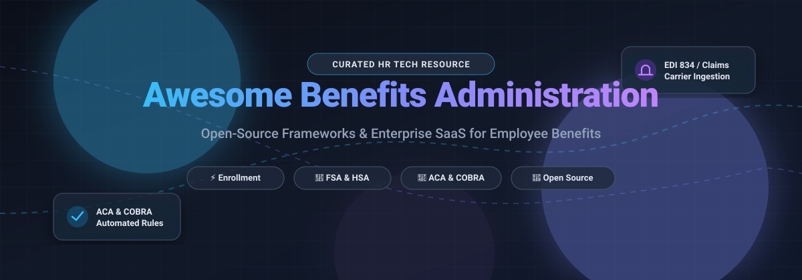

# 💼 Awesome Benefits Administration 🌟

  <strong>A curated directory of top-tier SaaS solutions, open-source platforms, EDI 834 toolkits, and compliance engines for employee benefits management.</strong>

  
  
  
  
  
  

  <em>Focused on Benefits Enrollment, Eligibility Verification, COBRA, FSA, HSA, 401(k), EDI 834 Integration & Employee Self-Service Portals.</em>

---

## 📑 Table of Contents

- [📈 Sector Overview & Market Dynamics](#-sector-overview--market-dynamics)
- [🏢 SaaS & Hosted Enterprise Platforms](#-saas--hosted-enterprise-platforms)
- [🔓 Open-Source GitHub Projects](#-open-source-github-projects)
  - [⭐ Featured HR & Benefits Suites](#-featured-hr--benefits-suites)
  - [🏛️ Public & Social Benefits Frameworks](#️-public--social-benefits-frameworks)
  - [🛠️ EDI 834 & Specialized Benefits Tools](#️-edi-834--specialized-benefits-tools)
- [🤝 How to Contribute](#-how-to-contribute)
- [💖 Support](#-support)
- [📊 Star History](#-star-history)
- [⚖️ Disclaimer](#️-disclaimer)

---

## 📈 Sector Overview & Market Dynamics

The global benefits administration software market is valued at approximately **$1.5 billion to $2.2 billion**, compounding at a CAGR of 10% to 13% driven by ACA/statutory compliance complexity, digital open enrollment, and AI-assisted plan decision tools. The sector is **moderately fragmented** rather than a winner-take-all monopoly—large enterprise HCM conglomerates (like ADP and Workday) compete alongside specialized mid-market benefits platforms (bswift, PlanSource, Businessolver) and modern SMB/mid-market HR tech unicorns (Rippling, Gusto), with frequent private equity consolidations across point-solution vendors.

---

## 🏢 SaaS & Hosted Enterprise Platforms

| Platform | Company Size (Revenue / Valuation) | Pricing (Starting Tier) | Free Tier / Trial Limits | Key Features & Focus |
| :--- | :--- | :--- | :--- | :--- |
| **[ADP Workforce Now](https://www.adp.com/)** | **~$119.3B Market Cap** ($20.6B FY25 Revenue) | ~$23.00/employee/mo (Select tier; benefits modules start in Plus tier at ~$30/employee/mo + base platform fee) | No free tier or trial; custom product sandbox available via sales | 🏢 Enterprise & mid-market HR, payroll, unified open enrollment, and ACA/compliance reporting. |
| **[Workday Benefits](https://www.workday.com/)** | **~$52B Market Cap** ($10.15B TTM Revenue) | ~$34.00 to $42.00/employee/mo (Core HCM subscription; typically $100K+ min. annual contract commitment) | No free tier or trial; guided custom enterprise demo only | 🌐 Full HCM & enterprise benefits administration with global payroll, deep carrier integrations, and lifecycle tracking. |
| **[Rippling](https://www.rippling.com/)** | **$16.8B Valuation** ($1B+ ARR) | $8.00/employee/mo (Unity platform base) + $35.00/mo base account fee; benefits administration module add-on starts at ~$5.00/employee/mo | No free tier; 14-day guided sandbox access upon sales qualification | ⚡ Modular all-in-one HRIS, payroll, automated benefits deductions on life events, device management, and broker sync. |
| **[Gusto](https://gusto.com/)** | **$9.3B Valuation** ($1B+ TTM Revenue) | $49.00/mo base fee + $6.00/employee/mo (Simple tier; full health benefits administration unlocked in Plus tier at $80/mo + $12/person/mo) | Unlimited free account setup ($0 until first live payroll run); promotional 30-day add-on feature trials | 🩺 SMB-focused automated payroll, health benefits enrollment, 401(k), FSA/HSA, and worker compensation sync. |
| **[bswift](https://www.bswift.com/)** | **$740M Valuation** (Acquired for $740M; ~$180M Revenue) | ~$8.00/employee/mo (Base benefits administration tier; custom quoting by population and lives covered) | No free tier or self-service trial; sales demonstration available | 🤖 End-to-end benefits platform with Emma™ AI decision support, dependent verification, billing reconciliation, and COBRA. |
| **[Benefitfocus](https://www.benefitfocus.com/)** | **$570M Valuation** (Acquired by Voya for $570M; ~$263M Revenue) | ~$2.00/employee/mo (Baseline BenefitsPlace entry fee; full enterprise scope quote-based) | No free tier or trial; scheduled pilot demo available for qualified employers | 🏥 Dedicated enterprise benefits exchange, complex spousal surcharge rules, multi-carrier billing, and ACA administration. |
| **[PlanSource](https://plansource.com/)** | **~$400M Valuation** (~$155M Revenue; Vista Equity-backed) | ~$3.75 to $5.00/employee/mo (Base platform tier; subject to volume discounting and setup fees) | No free tier or public trial; interactive demo sandbox on request | 🎯 Unified benefits platform with AI dependent verification, ACA/COBRA management, and direct carrier connections. |
| **[Businessolver](https://businessolver.com/)** | **~$350M Valuation** (~$285M Revenue; Stone Point Capital-backed) | ~$10.00/employee/mo (Benefitsolver baseline; scales up to $25–$50/PEPM for full suite and service advocacy) | No free tier or trial; personalized guided enterprise demo only | 💡 High-touch SaaS benefits tech featuring Sofia AI decision assistant, enrollment navigation, and consumer health accounts. |
| **[Sequoia One](https://www.sequoia.com/)** | **~$250M Valuation** (~$200M Revenue; Private Tech PEO) | ~$150.00 to $200.00/employee/mo (PEO model covering HR, Fortune 500-grade benefits, payroll, and 401k) | No free tier or trial; custom census review and consultation required | 🚀 Co-employment PEO tailored for venture-backed startups needing top-tier group health benefits and full compliance. |
| **[Zenefits](https://www.zenefits.com/)** (TriNet) | **~$100M Valuation** (Acquired by TriNet; ~$100M Historical ARR) | $8.00/employee/mo (Essentials tier billed annually; 5-employee minimum requirement of $40/mo) | No free tier or trial; guided demo available via sales consultation | 📱 SMB HR and benefits management, automated payroll deductions, employee onboarding, and broker integration. |

---

## 🔓 Open-Source GitHub Projects

Curated open-source projects, payroll-integrated benefit modules, social protection schemes, and healthcare data interchange tools—sorted by GitHub star count in descending order.

### ⭐ Featured HR & Benefits Suites

- **[Odoo](https://github.com/odoo/odoo)**  📦
  - **Overview**: Full-suite ERP system (LGPL-3.0) with comprehensive HR and payroll modules.
  - **Benefits Capabilities**: Manages salary allowances, medical allowances, company perks, and insurance components tied directly into employee contracts and payroll runs.
  - **Tech Stack**: Python, JavaScript, PostgreSQL.
  - **Best For**: Businesses requiring deep ERP-backed HR and contract-level benefits tracking.

- **[Frappe HR](https://github.com/frappe/hrms)**  🌟
  - **Overview**: Modern open-source HR and payroll suite (GPL-3.0) featuring dedicated **Flexible Benefits** and **Employee Benefit Claim** modules.
  - **Benefits Capabilities**: Configurable flexible benefit plans (health insurance, tuition reimbursement, medical allowances), Employee Benefit Application workflows for annual self-service selection, Benefit Ledger balance tracking, and reimbursement claim approval loops.
  - **Tech Stack**: Python (Frappe Framework), Vue.js (Frappe UI), MariaDB.
  - **Best For**: Organizations wanting native flexible benefits and reimbursement workflows integrated with payroll.

- **[GLPI](https://github.com/glpi-project/glpi)**  📑
  - **Overview**: Complete open-source service desk and resource management platform (GPL-3.0).
  - **Benefits Capabilities**: Used by internal HR and IT teams to orchestrate employee equipment benefits, fringe benefit requests, remote stipend tracking, and ticketed service allowances.
  - **Tech Stack**: PHP, MySQL.
  - **Best For**: Enterprise operational management of non-monetary fringe benefits and perks.

- **[Horilla HRMS](https://github.com/horilla-opensource/horilla)**  ⚡
  - **Overview**: Free and open-source Human Resource Management System (LGPL-3.0) built on Python/Django.
  - **Benefits Capabilities**: Includes dedicated salary allowance components, compensation planning, dynamic payslip generation, and customizable employee benefit deductions.
  - **Tech Stack**: Python, Django, HTML5, JavaScript.
  - **Best For**: Tech-forward HR teams seeking a clean, extensible Python codebase for compensation and benefits.

- **[OrangeHRM Community](https://github.com/orangehrm/orangehrm)**  🍊
  - **Overview**: Long-standing modular open-source HR management system (GPL-3.0).
  - **Benefits Capabilities**: Core benefits module allows defining health and medical coverage plans, assigning policies to employees, and tracking historical employee coverage tiers.
  - **Tech Stack**: PHP, Symfony, MySQL.
  - **Best For**: Small-to-midsize organizations needing foundational benefits recordkeeping alongside leave and time tracking.

- **[IceHrm](https://github.com/gamonoid/icehrm)**  🧊
  - **Overview**: Modular open-source HR management tool for distributed teams (Apache-2.0).
  - **Benefits Capabilities**: Track employee perks, expense claims, reimbursement workflows, and insurance policy assignments with a lightweight self-service interface.
  - **Tech Stack**: PHP, JavaScript, Bootstrap.
  - **Best For**: Startups and SMBs looking for lightweight, straightforward employee perk and claim recording.

- **[Sentrifugo](https://github.com/sentrifugo/sentrifugo)**  📋
  - **Overview**: Open-source HRMS (GPL-3.0) with extensible employee management fields.
  - **Benefits Capabilities**: Tracks employee benefit designations, dependent allocations, and emergency contact benefits data.
  - **Tech Stack**: PHP, Zend Framework, MySQL.
  - **Best For**: Teams needing on-premise basic employee benefit records alongside performance appraisals.

### 🏛️ Public & Social Benefits Frameworks

- **[openIMIS](https://github.com/openimis/openimis-dist_dkr)**  🏥
  - **Overview**: Digital Public Good for health financing and social protection schemes (AGPL-3.0).
  - **Benefits Capabilities**: Complete administration of public health insurance programs, beneficiary registries, healthcare claim processing, and HL7 FHIR-compliant health coverage APIs.
  - **Tech Stack**: Python (Django REST Framework), React, Docker.
  - **Best For**: Public health bodies, NGOs, and governments administering social health insurance and welfare payments.

- **[BenefitAssist](https://github.com/CMSgov/BenefitAssist)**  🛡️
  - **Overview**: Open-source public benefits screening tool originally developed by Intuit and maintained by the U.S. Centers for Medicare & Medicaid Services (Apache-2.0).
  - **Benefits Capabilities**: Rules-based eligibility engine that prescreens applicants for federal and state assistance programs (Medicaid, SNAP, TANF, LIHEAP).
  - **Tech Stack**: JavaScript, Node.js, Express.
  - **Best For**: Civic tech developers and government agencies building automated benefit screening tools.

- **[Forus](https://github.com/teamforus/Forus)**  🏙️
  - **Overview**: Multi-tenant open-source SaaS platform for municipal social benefits administration (MIT / AGPL-3.0).
  - **Benefits Capabilities**: Budget allocation, provider network validation, and issuance of social assistance packages via direct payouts, QR code vouchers, and subsidized service credits.
  - **Tech Stack**: PHP (Laravel), Vue.js, Go.
  - **Best For**: Municipalities, local governments, and non-profits managing targeted social assistance funds.

### 🛠️ EDI 834 & Specialized Benefits Tools

- **[FastChickensHR EDI](https://github.com/FastChickensHR/edi)**  🔄
  - **Overview**: Open-source Java library specifically built for HIPAA-compliant **EDI 834 Benefit Enrollment and Maintenance** transactions.
  - **Benefits Capabilities**: Programmatically builds and parses ASC X12N 834 (enrollment, changes, terminations) and 999 implementation acknowledgment files for health insurance carriers.
  - **Tech Stack**: Java, X12 parser architecture.
  - **Best For**: Developers building custom bridges between HRIS platforms and health insurance carrier feeds.

---

## 🤝 How to Contribute

Contributions are warmly welcome! Help make this the most comprehensive and transparent benefits administration resource on GitHub.

1. 🍴 **Fork the repo** to your personal GitHub account.
2. 🌿 **Create a feature branch** (`git checkout -b add-benefits-tool`).
3. ✍️ **Add or update entries** in `README.md` keeping formatting consistent (Name, star badge, link, company size/stars, pricing details, and key focus).
4. 🚀 **Submit a Pull Request** with a concise description of your additions.

---

## 💖 Support

If you found this curated directory useful for navigating benefits administration tools, evaluating HR software, or building custom benefits workflows:

- ⭐ **Star this repository** to help others discover it!
- 🍴 **Fork and share** it with your engineering and HR communities.
- ☕ **Buy me a coffee**: Support ongoing curation, open-source maintenance, and research on the [GitHub Sponsors Dashboard](https://github.com/sponsors/ishandutta2007).

---

## 📊 Star History

---

## ⚖️ Disclaimer

- This repository is a **community-curated index** for informational and research purposes only—it does not constitute financial, legal, or health insurance advice.
- Benefits administration tools handle sensitive protected health information (PHI) and personally identifiable information (PII). Deployments must strictly comply with **HIPAA, GDPR, CCPA**, and relevant regional data protection mandates.
- **Corporate Employee Benefits vs. Social Benefits**: Please note that platforms like **Frappe HR**, **Odoo**, and **Horilla** handle corporate employee benefits and payroll components. Systems like **openIMIS**, **BenefitAssist**, and **Forus** are purpose-built for government welfare and social health schemes. Select according to your exact operational scope.

---

  Built with ❤️ for HR leaders, software engineers, and benefits innovators worldwide.

